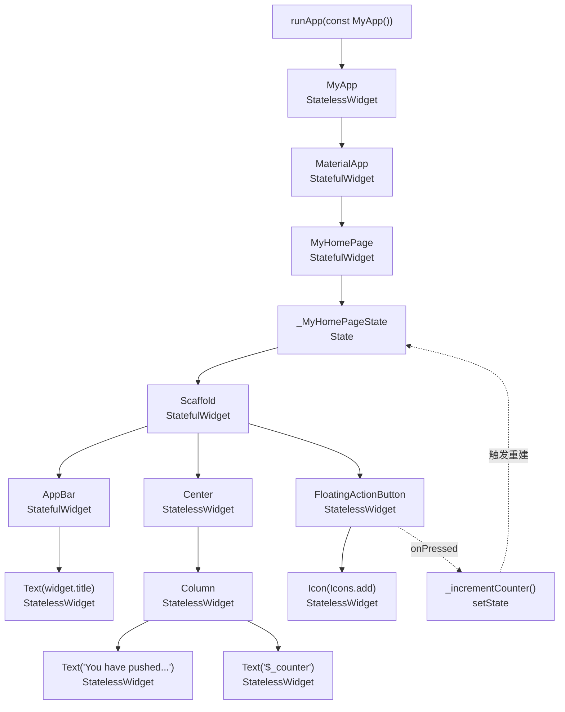

# counter_deep Widget 树（flutter create 默认计数器）

配套图：[widget_tree.svg](widget_tree.svg)。源码：[lib/main.dart](../lib/main.dart)。

## 1. 树形结构

```
runApp(const MyApp())
└── MyApp                        StatelessWidget
    └── MaterialApp              StatefulWidget
        └── home: MyHomePage     StatefulWidget
            └── State<_MyHomePageState>   State（持有 int _counter）
                └── Scaffold     StatefulWidget
                    ├── appBar: AppBar          StatefulWidget
                    │   └── title: Text(widget.title)   StatelessWidget
                    ├── body: Center            StatelessWidget
                    │   └── Column              StatelessWidget
                    │       ├── Text('You have pushed the button this many times:')  StatelessWidget
                    │       └── Text('$_counter')                                    StatelessWidget
                    └── floatingActionButton: FloatingActionButton  StatelessWidget
                        └── child: Icon(Icons.add)   StatelessWidget
                        （onPressed → _incrementCounter → setState）
```

## 2. 结构说明

- **入口**：`main()` 只调用 `runApp(const MyApp())`，把根 Widget 挂到引擎上。
- **MyApp**：`StatelessWidget`，只负责组装 `MaterialApp`（标题 + 主题），自身没有可变状态；因为是 `const`，重建时不会重新创建实例。
- **MaterialApp / Scaffold / AppBar**：看起来像"外壳"，其实都是 `StatefulWidget`——它们内部要管理路由栈、动画、抽屉等状态，所以源码里 `extends StatefulWidget`。
- **MyHomePage**：`StatefulWidget`，只保存不可变的 `title`，并 `createState()` 生成 `_MyHomePageState`。
- **State**：真正持有 `_counter` 的地方。`_incrementCounter()` 用 `setState()` 包裹 `_counter++`，框架据此重跑 `build()`，只刷新需要更新的 `Text`。
- **叶子节点**：`Text`、`Icon` 都是 `StatelessWidget`，没有子节点，是整棵树的渲染终点。

## 3. 易混点

| 类型 | 判断依据 | 本树中的例子 |
| --- | --- | --- |
| StatelessWidget | 无 `createState()`，界面只由构造参数决定 | MyApp、Center、Column、Text、Icon、FloatingActionButton |
| StatefulWidget | 有 `createState()`，状态在配套 State 类里 | MaterialApp、MyHomePage、Scaffold、AppBar |

> 记忆点：是否"有状态"与是否"有动画/内部机制"无关，只看这个类是不是 `extends StatefulWidget`。

## 4. Mermaid 版本


